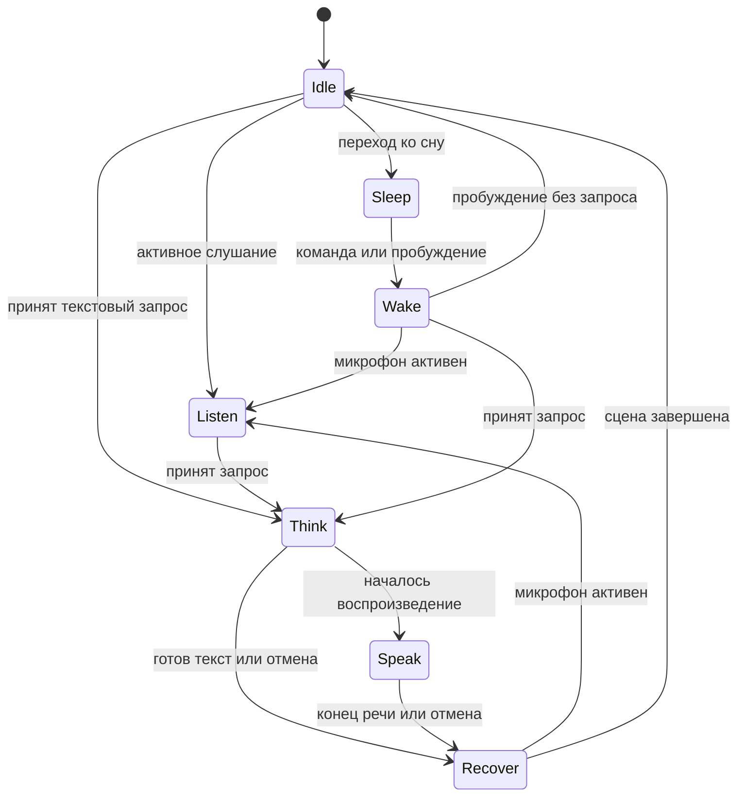

# Capri · план переработки анимации

4 ноября 2026 · проект для реализации поверх desktop-клиента v0.4.6.

[Этап 1 · аниматик и контрольный прогон v1](capri-animation-stage1.md).

Capri должна ощущаться как нарисованный персонаж в одном непрерывном кадре. Когда к ней обращаются, первым реагирует взгляд. Подбородок и плечи догоняют его, волосы останавливаются последними. При паузе она удерживает осмысленную позу. При отмене обрывается действие, а движение доходит до ближайшей естественной остановки.

Визуальный ориентир — графичная режиссура официального тизера _Cyberpunk: Edgerunners 2_ от CD PROJEKT RED и TRIGGER. Предложение для Capri — переносить в портрет контраст выдержанной позы и короткого резкого акцента, читаемый силуэт и ритм цветовых плоскостей. Режиссуру, рисунки, длительности и кадрирование проектируем для окна Capri. [Официальный тизер](https://www.cyberpunk.net/en/news/51984/just-released-cyberpunk-edgerunners-2-official-teaser-2).

## От чего отталкиваемся

В CapriDesign исходная задача задавала прозрачный холст, нейтральную улыбку и общую рамку для следующих спрайтов. Локальный архив содержит 80 PNG, включая одно сердечко, и историю отбора. Активный набор содержит 68 кадров, 39 сохраняемых состояний и 9 действий, видимых модели. В активном наборе 14 клипов и четыре переходных рисунка смены поз. Двенадцать кадров походки хранятся в авторском наборе. Канонический разговорный рот — цельный белый угловатый клин, у которого меняется раскрытие. Это зафиксированное решение сохраняем для многоязычной речи. [CapriDesign](thread://01a16db4-32f0-7d81-aedc-13ce672f0656?hostId=local) · [авторский набор](../../assets/capri/sprites/v1/complete-README.md) · [производственный журнал](../capri-sprite-generation-plan.md).

| Наблюдение                                    | Что происходит в коде                                                                                                                                                                                                                                 | Что меняем                                                                                                                                               |
| --------------------------------------------- | ----------------------------------------------------------------------------------------------------------------------------------------------------------------------------------------------------------------------------------------------------- | -------------------------------------------------------------------------------------------------------------------------------------------------------- |
| Поза перескакивает при новом намерении        | `select()` начинает от прежнего семантического `base`, сбрасывает текущий клип и знает только три перехода. `attend()` может сбросить фоновое действие прямо к базовому рисунку.                                                                      | Режиссёр строит маршрут от последнего **показанного** кадра и его опор. Действия получают точки прерывания и рисованный выход.                           |
| У рисунков заметен дрейф                      | Большинство авторских изображений получено отдельной генерацией. Совпадение размеров PNG и ориентиров опоры оставляет разницу в масштабе головы, контурах, руках и фактуре.                                                                           | Один утверждённый мастер на семью поз. Перемены лица рисуются на совмещённых слоях. Переходы проверяются наложением и силуэтом.                          |
| Часть кадров может вообще не попасть на экран | В `showAvatar()` готовится базовый PNG, далее клип уже идёт по времени. `animateCharacter()` ждёт декодирование, потом ждёт IPC, где главный процесс обновляет альфа-маску. Запоздавший кадр выбрасывается. Темп тела также зависит от тика эффектов. | Подготовить вступление клипа до старта, дать телу собственные часы, хранить маски в подготовленном пакете. Публикация показанного кадра идёт асинхронно. |
| Речь и моргание исчезают в других позах       | `tick()` заменяет целый PNG головы и тела для раскрытий рта и моргания, преимущественно на `neutral`. Сон перескакивает к закрытым глазам.                                                                                                            | Лицо, взгляд, тело и эффект получают отдельные дорожки. Поза явно объявляет, какие дорожки допустимы и чем перекрывается лицо.                           |

Базовые проверки каталога, протокола, раскладки и установки прошли 22/22. Они подтверждают текущие контракты. Плавность движения требует отдельных проверок. [Текущий режиссёр](../../apps/desktop/renderer/animation-director.mjs#L20) · [отрисовка](../../apps/desktop/renderer/app.js#L729) · [IPC кадра](../../apps/desktop/main.mjs#L3539) · [совмещение опоры](../../apps/desktop/avatar-layout.mjs#L41).

## Постановка

- Для каждого состояния определить силуэт и направление взгляда, которые читаются в реальном размере портрета. «Слушаю» — фокус взгляда и небольшой перенос корпуса. «Думаю» — отвод взгляда, неподвижный вес и выдержанная пауза. «Говорю» — взгляд возвращается к собеседнику, плечи держат позу, рот и голова акцентируют фразу. «Сплю» — мягкая линия плеч и закрытые глаза.
- Зафиксировать асимметрию глаз, волос и деталей костюма на листе модели. Правый и левый повороты рисуются отдельно. У затылка и крупных плоскостей волос есть пределы амплитуды, у силуэта — безопасные поля для жеста.
- Основной рисунок двигается ступенчато по авторским экспозициям на сетке 24 кадра/с. Для текущего теста позы держатся на тройках или дольше, короткие акценты и формы рта могут идти на двойках. Корпус и конечности берутся из цельного рисунка. Презентация, перемещение окна и локальные эффекты получают собственный темп.
- Акцент сигнала разрешён только там, где у клипа есть отметка режиссёра. Один короткий контур или цветовой разрыв внутри портрета может подчеркнуть реакцию. Читаемость каждой сцены проверяется с выключенными эффектами. Дрожание камеры и яркие вспышки исключаются из повседневных состояний.
- У тела один выразительный центр за раз. На фокусе глаз плечи спокойны, на акценте жеста взгляд держит направление. Для ожидания предусмотреть редкие варианты дыхания и моргания с нерегулярными паузами. Первая версия жестов использует один акцент на ответ. Период тишины между автономными жестами задаётся настройкой и сбрасывается активностью пользователя.

### Раскадровка и экспозиция

Каждую сцену проверяем по чёрному силуэту на светлом фоне, в цвете с выключенными эффектами и в окне Capri. В черновом аниматике кадр подписывается временем, опорой, направлением взгляда, дорожкой рта и возможной точкой выхода. Номер F обозначает кадр на сетке 24 кадра/с.

| Сцена                                              | Экспозиция и действие                                                                                                                                                                                                                                                                | Опора и выход                                                                                                                                                                               |
| -------------------------------------------------- | ------------------------------------------------------------------------------------------------------------------------------------------------------------------------------------------------------------------------------------------------------------------------------------ | ------------------------------------------------------------------------------------------------------------------------------------------------------------------------------------------- |
| **«Услышала тебя»** · покой → внимание             | F00–01 глаза находят цель. F02–03 поднимается подбородок. F04–05 плечи подаются вперёд. F06–07 волосы доходят до пика, F08–09 возвращаются на место. С F10 удерживаем внимательный взгляд. Фокус меняется в первые ~83 мс, тело успокаивается примерно за 420 мс.                    | Стопы держат одну линию. В F02 и F06 предусмотрен выход в короткую остановку. Если пришёл новый запрос, внимание уже видно по глазам и в следующем движении не нужно повторять подъём плеч. |
| **«Подобрала ответ»** · мысль → речь               | Пока TTS готовится, держим задумчивый взгляд и сомкнутый рот. С фактического старта аудио F00–01 глаза возвращаются, открытие рта следует за PCM. F02–05 голова возвращается и плечи подхватывают движение. F06–09 мягкая остановка. На следующем ударном слоге возможен один кивок. | При паузе между фразами рот закрывается, корпус остаётся в разговорной позе. Ответ текстом использует тот же возврат взгляда, рот остаётся в покое.                                         |
| **«Перебили на полуслове»** · речь/жест → внимание | В момент отмены прекращается звук и сбрасывается дорожка рта. Взгляд откликается в ближайшем доступном кадре. Для показанной позиции руки есть метки на подъёме, в акценте и в возврате. От любой из них 3–6 экспозиций ведут в посадку руки и внимательную позу.                    | Отправной кадр — тот, который реально показан. Если звук прекратился в середине жеста, не доигрываем акцент. Рука проходит по собственной дуге, волосы догоняют остановку.                  |
| **«Проснулась»** · сон → внимание                  | F00–02 глаза приоткрываются. F03–05 взгляд фокусируется. F06–09 голова и корпус поднимаются. F10–13 волосы завершают движение. С F14 удерживаем позу внимания. Засыпание рисуется отдельно с замедлением и выдержкой закрытых глаз.                                                  | Первый вариант использует одну семью поз и ту же опору. Для сна сидя сначала меняется взгляд и выпрямляется корпус. Если Capri нужно встать, вес затем переходит с сиденья на стопы.        |
| **«Устроилась на краю»** · стоя ↔ сидя            | Отдельная сцена для следующего пакета. Перенос веса → поиск края рукой → посадка → свес ног → остановка. При подъёме рука освобождается после того, как ноги приняли вес.                                                                                                            | Манифест фиксирует поверхность края, таз и ладонь. Точка перехода от стоп к сиденью задана конкретной экспозицией. Проверяем посадку на разном масштабе и при смещении портрета.            |

Сначала выпускаем 12–18-секундный аниматик со сценами внимания, размышления, короткой фразы с паузой и прерывания в середине жеста. Для этого нужны статичные ключи и черновые промежуточные рисунки. Чистовые кадры делаются после утверждения направления движения и темпа, чтобы правки опор не пришлось повторять на всей серии.

## От эскиза к пакету

1. **Лист модели.** Выбрать утверждённый `capri-neutral.png` и опорные виды из CapriDesign. Зафиксировать пропорции, палитру, крупные плоскости волос, свет и силуэт в профиль/три четверти. Обозначить уровни стоп, пола и края окна, ось лица, центры глаз, кисть и локоть. Авторский холст 1254 × 1254 остаётся общей системой координат.
2. **Ключи и промежутки.** Старые PNG служат позами-ориентирами. Из пригодных ключей выделить управляемые слои и перерисовать несовпадающие границы по мастеру. Для большого движения сначала нарисовать экстремумы и кадр переноса веса, затем промежутки. Переходы с разным силуэтом используют отдельный рисунок для каждой экспозиции. Короткое смешивание допустимо на совмещённых лицевых слоях. Генерация помогает на этапе черновиков, а каждую удачную деталь переносим на совмещённый мастер. Сохранять исходник, версию, автора/инструмент и решение об отборе.
3. **Лицо и фактура.** Для пилота нужны покой и три величины белого клина, полный/частичный блинк и слои направления взгляда. В каждой семье поз указать точки привязки и порядок перекрытия. Поцелуй, рука на подбородке и другие перекрытия явно выключают соответствующий слой. Зерно волос привязано к плоскости, края проверяются на светлом и тёмном фоне.
4. **Экспорт.** Авторские листы, видео, референсы и отвергнутые варианты хранятся отдельно от файлов приложения. Сборщик экспортирует ограниченные листы кадров и нужные масштабы, хеши, точки регистрации и маски. При обрезке прозрачных краёв записывается смещение в исходном холсте, поэтому визуальный размер не зависит от рамки PNG. Первые целевые уровни — 768 и 1254 логических пикселей по длинной стороне холста. Выбрать их по сравнению в окне на нескольких DPI, менять уровень между клипами.

Первый пакет ориентировочно потребует **30–45 уникальных рисунков тела и переходов** плюс наборы лица. Длинная выдержка использует одну и ту же картинку. Набор поз в полный рост расширяем после проверки этого пакета. Инвентарь и условия распространения фиксируются по существующим правилам проекта. [Разделение исходников и распространяемого арта](../character-assets.md).

## Изменения в коде

### Манифест пакета и маршруты

Текущий `v1` арт использует `schemaVersion: 2`. Новый пакет `assets/capri/sprites/v2/` получает `schemaVersion: 3`. Загрузчик получает разбор новой версии и отдельную проекцию для renderer. Сборщик сохраняет выпуск v1 и получает режим сборки нового пакета. [Загрузчик](../../apps/desktop/avatar-catalog.mjs) · [сборщик](../../tools/assets/build-sprite-catalog.mjs).

| Запись    | Минимальный контракт                                                                                                                                                                                                                                   |
| --------- | ------------------------------------------------------------------------------------------------------------------------------------------------------------------------------------------------------------------------------------------------------ |
| Рисунок   | `id`, ресурс и SHA-256, прямоугольник в листе, смещение в холсте, `poseFamily`, точки крепления лица, допустимые перекрытия и ID маски тела.                                                                                                           |
| Клип      | `id`, `entryPose`, `exitPose`, список `{frameId, holdTicks}` на сетке 24, границы цикла, маркеры выхода, контакты, кадр для Reduced Motion и локальные акценты. Время рассчитывается по накопленным тикам, чтобы дробные миллисекунды не давали дрейф. |
| Переход   | От какой семьи, клипа или маркера можно начать, к какой позе ведёт, какой мост используется и как долго допустимо ждать. Поддерживаются переходы внутри семьи и смена опоры.                                                                           |
| Семантика | Совместимые публичные ID, поза покоя и разрешённые реакции. Промпт и [avatar-protocol.mjs](../../apps/desktop/avatar-protocol.mjs) по-прежнему работают с семантическими ID. Список кадров, длительность, файлы и граф остаются внутри приложения.     |

Сборка отклоняет неполные листы и графы с недостижимыми состояниями, неверные рамки, дубли, ссылки за пределы пакета, нулевые экспозиции, несогласованные точки опоры и маркеры без безопасного пути выхода. Новый формат разрешает экспозицию около 41,7 мс. У старого валидатора нижняя граница — 50 мс. Для сохранённых настроек и старых ID предусмотрен явный словарь совместимости с утверждённой нейтральной позой по умолчанию.

### Режиссёр и состояние в Electron

Арбитр входных событий выбирает намерение, чистый проигрыватель ведёт граф, а контроллер портрета отвечает за показ. Данные для принятия решений уже есть у приложения. Речь берётся из проигрывателя, слушание — из реального режима записи, ожидание ответа — из жизненного цикла запроса. Состояние, выбранное моделью, даёт выражение и намерение жеста в рамках доступного набора.

- Хранить отдельно запрошенное намерение, позицию клипа и последнюю **представленную** композицию. В `AnimationDirector` новый запрос выбирает переход от этой композиции. До старта проверяется декодированное вступление. Для пилота путь состоит максимум из одного промежуточного моста через опорную позу и одного целевого клипа. Если подходящий мост ещё не готов, удерживаем последний валидный кадр, лицо может откликнуться отдельно.
- Закрытие, скрытие и остановка имеют наивысший приоритет. Следом идут пробуждение или явное обращение, запись и воспроизведение текущего запроса, размышление, реакция по выбранному выражению и фоновое действие. Отмена останавливает аудио и запрещает старые события сразу. Режиссёр ждёт ближайший разрешённый маркер до ~120 мс, затем применяет предусмотренный короткий выход. Хранится одна цель, отложенные реакции заменяются свежим намерением.
- В [app.js](../../apps/desktop/renderer/app.js#L729) выделить контроллер портрета с собственным монотонным временем и презентацией через `requestAnimationFrame` только при видимости. [SignalFX](../../apps/desktop/renderer/signal-fx.mjs) получает уже составленный кадр через адаптер. При отключённых эффектах темп тела и губ остаётся тем же. Предусмотреть отображение Canvas 2D при потере WebGL.
- Семантическое подтверждение и отчёт о показанном кадре остаются разными сообщениями. [AvatarState](../../apps/desktop/avatar-state.mjs) подтверждает сохраняемое состояние только после презентации подходящего кадра для актуальной ревизии. В актуальных жестах сохраняется их стабильная поза возврата. Старые ответы на декодирование и IPC отбрасываются по `revision` и поколению пакета. Идентификаторы промежуточных рисунков не попадают в историю.
- Для точного перетаскивания и пропуска кликов заменить PNG-декодирование в главном процессе заранее собранными масками тела. После презентации передавать один пакет с ID тела/маски, порядковым номером, областью обрезки, положением и масштабом. Главный процесс сверяет ID с каталогом и проверяет геометрию. Рот, моргание и декоративный эффект не меняют область захвата. Согласованность видимого кадра и маски проверяется на реальной прозрачной области окна. [Граница ресурсов](../../apps/desktop/main/resources.mjs) · [установка текущей маски](../../apps/desktop/main.mjs#L3539).
- Сворачиваемые панели, трей, скрытие окна и перетаскивание останавливают ненужные тики. Видимость native-окна сообщается отдельно от `document.visibilityState`. После восстановления актуализируем намерение и возобновляем движение от последнего показанного рисунка либо от его устойчивой опоры. Учитываем реальный ход аудио, старые фоновые кадры не догоняем. Reduced Motion оставляет устойчивые позы и сохраняет разборчивость состояния. Интенсивность эффектов управляется независимо.

### Речь и нагрузка

В [voice-player.mjs](../../apps/desktop/renderer/voice-player.mjs#L58) уже есть `AudioContext.currentTime`, длительность воспроизведения и события `started / ended / stopped`. Для MVP получить огибающую громкости из локального PCM или сухой дорожки до реверберации. Семплировать её по времени текущего аудио и связывать с `turnId + sequence`. Три уровня раскрытия используют сглаживание и гистерезис, минимальная выдержка формы 60–100 мс. Силуэт губ при отмене закрывается независимо от тела, звуковой хвост эффектов его не оживляет. Точные фонемы добавляются только после проверки выравнивания для конкретного TTS; общий путь работает с локальными и API-подключениями без новых сетевых запросов.

Текущий кэш на 20 PNG по 1254 × 1254 соответствует примерно 120 МиБ распакованного RGBA, без учёта текстур и масок. Полная загрузка всех 68 PNG дала бы около 408 МиБ. Новый кэш считает декодированные байты, удерживает текущий кадр, ближайшую фазу и устойчивый запасной кадр, ограничивает параллельное декодирование и освобождает просроченные изображения. Сначала пробуем не более двух задач декодирования и 48 МиБ под активные изображения, замеряем фактическое потребление отдельно от размера файлов. CPU/GPU, DPI и размер окна проверяем сравнением с v1. На слабом ПК приоритет получает движение тела, затем лицо, затем декор.

## Очерёдность внедрения и критерии приёмки

| Этап                                  | Что входит                                                                                                                                                                                                                                                                                                                                                                               | Когда идти дальше                                                                                                                                                                                        |
| ------------------------------------- | ---------------------------------------------------------------------------------------------------------------------------------------------------------------------------------------------------------------------------------------------------------------------------------------------------------------------------------------------------------------------------------------- | -------------------------------------------------------------------------------------------------------------------------------------------------------------------------------------------------------- |
| **1. Базовые замеры и аниматик**      | Записать тот же сценарий в v1 при обычном и компактном режиме. Визуально утвердить силуэт, экспозицию, паузу, фокус взгляда и прерывание на черновых рисунках.                                                                                                                                                                                                                           | Режиссура читается без звука и глитча. Зафиксированы контактные листы и контрольные кадры.                                                                                                               |
| **2. Проигрыватель и первый маршрут** | Каталог v3, проверки ссылок, детерминированные часы, переход «покой → внимание → мысль → речь → выход». Тестовый пакет переключается в отладочной/экспериментальной настройке.                                                                                                                                                                                                           | Устаревший кадр и запоздавший decode не возвращают прошлую позу. При быстром повторном запросе есть непрерывный выход. v1 проходит прежние тесты.                                                        |
| **3. Лицо и прерывания**              | Составление слоёв, реальные часы речи, маски без покадрового декодирования в main, короткие выходы из жестов, сон и пробуждение.                                                                                                                                                                                                                                                         | Проверены обрыв в начале, середине и конце, очередь TTS, пауза, текстовый режим, таймеры видимости и реальный проход клика через прозрачность.                                                           |
| **4. Расширение поз**                 | Опоры пола и края, посадка и подъём, потом по одному утверждённому жесту за раз. Походка требует отдельного аниматика и новой проверки опор.                                                                                                                                                                                                                                             | При смене поверхности таз, ладонь и стопы попадают в нарисованные контакты. Перетаскивание, поворот взгляда и переход на другом DPI не сдвигают персонажа относительно выбранной позиции.                |
| **5. Сборка и включение**             | [Список файлов установщика](../../packages/installer/src/payload.mjs#L65), [экспорт](../../tools/release/source-export.mjs), проверка повреждённого пакета и repair. Проверить предел распакованного source-пакета 100 МиБ в [launcher.cs](../../packages/installer/windows/launcher.cs). При необходимости выпускать арт отдельным проверяемым пакетом с хешами и локальной установкой. | Установка с чистого профиля, обновление с v1 и возврат на v1 проходят. Настройки размещения сохраняются. При ошибке v2 остаётся рабочий v1; при неполном optional-клипе остаётся устойчивый кадр пакета. |

Начальные пороги приёмки пилота.

- **Актёрская игра.** Внимание, мысль, речь и сон опознаются при выключенном FX в реальном размере портрета. В контрольных точках дрейф закреплённой опоры не больше 1 CSS px при обычном масштабе. На длинной выдержке меняются только заявленные слои. Контактные листы, наложения контуров и короткая запись принимаются перед экспортом.
- **Часы.** P95 до первого видимого отклика на прогретом пакете до 100 мс. Целевой бюджет от старта аудио до первого движения рта до 80 мс. Измерять отдельно холодный decode, тишину между фразами и обрыв. При 60/120/144 Гц темп клипа не меняется. При скрытии окна визуальный цикл останавливается, новые задачи декодирования не ставятся, результаты уже запущенных задач отбрасываются.
- **Плавность и ресурс.** На измеренном слабом ПК целиться в P95 работы контроллера и композиции до 4 мс на обновление, отдельно замерять влияние CRT и чтения масок. Прогнать 30 минут чередования состояний, таймеров, сворачивания и речи. Память после прогрева держится в установленном бюджете. Порог уточняется по замерам v1 и пилота до принятия арт-пакета.
- **Регрессии.** [desktop-animation.test.mjs](../../tests/desktop-animation.test.mjs), [desktop-avatar.test.mjs](../../tests/desktop-avatar.test.mjs) и [avatar-installation.test.mjs](../../tests/avatar-installation.test.mjs) дополняются проверками графа, ревизий, несовпадающих масок и отсутствующих ресурсов. [Нативный verify-visuals](../../tools/verify/verify-visuals.mjs) записывает последовательности кадров и проверяет Windows 100/125/150/200%, компактное окно, клики, drag, tray/restore, отключённые эффекты и Reduced Motion. Для речи используются тестовые PCM-фразы с известным началом и паузами.

Первое решение, которое нужно принять по результату аниматика, — насколько заметным должно быть движение в маленьком окне. После утверждения ритма и четырёх базовых состояний те же критерии применяются к посадке, жестам и остальным позам.
