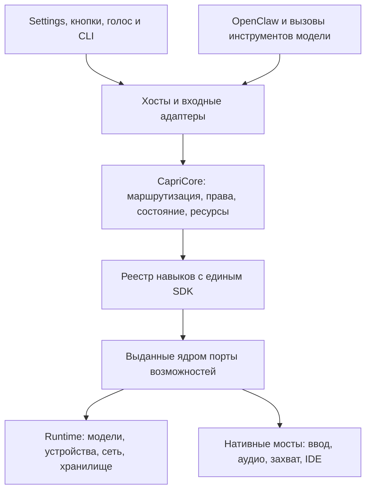

# План модульного рефакторинга CapriCore

Проектная основа — рабочая копия ветки `codex/native-npu-legacy-coding-control` на базе `6b2e391`, версия проекта 1.0.5. План описывает целевую архитектуру и последовательность внедрения. Каждый этап должен оставлять приложение пригодным к сборке, запуску и обновлению.

## 1. Откуда начинаем

| Текущая точка                                                                               | Что она делает                                                                                                                              | Граница после переноса                                                                                                                        |
| ------------------------------------------------------------------------------------------- | ------------------------------------------------------------------------------------------------------------------------------------------- | --------------------------------------------------------------------------------------------------------------------------------------------- |
| `apps/desktop/main.mjs`                                                                     | Собирает Electron и сервисы, хранит состояния режимов, запускает голос, захват, компьютерный агент и напоминания, вручную останавливает их. | Точка сборки зависимостей, окна, tray, preload и нативные адаптеры. Прикладной жизненный цикл делегирован ядру.                               |
| `apps/desktop/chat-service.mjs`, `request-router.mjs`, `task-route.mjs`, `turn-context.mjs` | Выбирают маршрут запроса, строят контекст и ведут стрим. В цепочке есть ветви для кодинга, Spotify, компьютера, памяти и поиска.            | `TurnCoordinator` владеет состоянием запроса и порядком стадий. Навыки предоставляют маршруты, исполнителей и ограниченные вклады в контекст. |
| `companion-actions.mjs`, `action-broker.mjs`, `full-computer-access.mjs`                    | Разбирают вызовы OpenClaw, проверяют согласие и выполняют действия.                                                                         | Адаптеры текущих имён инструментов и общий брокер прав, использующий существующие проверки и квитанции.                                       |
| `apps/desktop/main/ipc.mjs`, `preload.cjs`, `renderer/settings-registry.mjs`                | IPC привязан к конкретному локальному окну и роли. Settings и кнопки привязаны к отдельным обработчикам.                                    | Существующие роли, названия секций и расположение контролов. Переходники направляют кнопки и Settings в один контракт навыка.                 |
| `packages/runtime/src`, `integrations`                                                      | Запуск локальных процессов, OpenClaw/Ollama, провайдеры, модели, обнаружение устройств и нативные мосты.                                    | Инфраструктура и реализации портов ядра. Драйвер GPU, API-провайдер и launcher модели не регистрируются как навыки.                           |
| `tool-manifest.mjs`, `user-tools.mjs`, `native/tool-sandbox.cs`                             | Расширения пользователя уже имеют манифесты, закреплённые разрешения и запуск в изоляции.                                                   | Один встроенный навык-адаптер для текущего формата. Подключение сторонних навыков опирается на этот контур изоляции.                          |

## 2. Целевая структура

```text
packages/
  skill-sdk/     версии протокола, схемы, ошибки, JSDoc, тестовый harness
  core/          registry, dispatch, turn, policy, resources, state, diagnostics
  skills/        каталог встроенных навыков, один публичный вход на навык
  runtime/       конфигурация установки, модели, провайдеры, процессы и устройства
  installer/     установка, обновление и восстановление
apps/desktop/    Electron, интерфейс, OS-адаптеры и сборка CapriCore
integrations/    существующие мосты Windows, Python и OpenClaw
```

Оставляем Node ESM и текущий формат `.mjs`. Добавляем workspace-пакеты `@capri/skill-sdk`, `@capri/core` и `@capri/skills`. Каждый встроенный навык получает отдельную папку и экспорт регистрации. Пакет SDK содержит только контракты и проверку данных. Ядро тестируется в Node без Electron, установщика и загрузки модели.



Точка сборки `apps/desktop/main/create-core.mjs` создаёт CapriCore и явно регистрирует навыки, доступные на конкретном хосте. Ядро не импортирует реализации навыков. Навыки импортируют SDK и собственные файлы. Нативные адаптеры используют существующие реализации из `integrations/`. Для зависимости одного навыка от другого ядро выдаёт контракт возможности или маршрутизирует именованную команду с теми же проверками прав. Так, таймер отправляет запрос на озвучивание через порт уведомлений, а навык кодинга использует порт IDE.

Взаимозаменяемость действует на уровне контракта. Например, два поисковых провайдера используют один порт поиска, а альтернативная реализация встроенного навыка объявляет те же команды и события. Выбор реализации выполняет хост при сборке или переключении провайдера. Реестр отклоняет повторяющиеся идентификаторы и несовместимые версии. Замена во время активной операции проходит через отмену или завершение операции и освобождение ресурсов перед запуском нового экземпляра.

## 3. Контракт навыка

Публичный интерфейс SDK — типизированный локальный протокол между хостом, ядром и навыком. Команды проходят через один диспетчер. Для сторонних процессов позднее используется тот же контракт с транспортом RPC.

```js
export const manifest = {
  id: 'capri.timers',
  version: '1.0.0',
  apiVersion: 1,
  settingsVersion: 1,
  requires: ['scheduler.v1', 'notifications.v1', 'storage.v1'],
  commands: { create: createSchema, cancel: cancelSchema, list: listSchema },
  permissions: { create: ['timers.write'], cancel: ['timers.write'], list: ['timers.read'] },
  events: { changed: timerChangedSchema, fired: timerFiredSchema },
  settings: timerSettingsSchema,
  ui: { sectionId: 'time', labelKey: 'Timers and reminders' },
};

export function createSkill(context) {
  return {
    async invoke(command, input, operation) {
      /* operation.signal, deadline, requestId */
    },
    async dispose() {
      /* release acquired resources */
    },
  };
}
```

- **Регистрация.** `registry.register(manifest, factory)` валидирует манифест и совместимость. `core.describeSkills()` возвращает публичные дескрипторы и доступность. `factory` вызывается лениво для команды, активированного фонового режима или восстановления существующего задания.
- **Команды.** `core.dispatch({ skillId, command, input, requestId }, actor)` валидирует вход, происхождение запроса, доступность и права на конкретное действие. `actor` создаёт хост после проверки IPC, системного события или зарегистрированного инструмента модели. Поля идентичности из пользовательского JSON не дают полномочий. Внутри обработчика `operation` содержит `signal`, крайний срок, идентификаторы запроса и родительского turn.
- **Результат.** Дискриминированное объединение со статусами `ok`, `needs_approval`, `unavailable`, `cancelled`, `failed`. Для `ok` есть схема результата и, где уместно, проверяемая квитанция. `needs_approval` возвращает ссылку на подтверждение, которым владеет хост. Технические исключения преобразуются в безопасный код и ключ локализации. Приём команды, отправка ввода и подтверждение конечного эффекта остаются разными состояниями.
- **События.** `subscribe(filter, listener)` отдаёт события с пространством имён навыка, `requestId`, версией схемы и номером последовательности в пределах операции. Данные валидируются на выходе. Renderer получает только разрешённые проекции. После переподключения он читает текущий snapshot и подписывается на последующие изменения, включая переходы режима и состояние активной задачи.
- **Настройки.** `core.getSkillState(id)` возвращает `desiredEnabled`, `effectiveState`, `reasonCode`, `settingsRevision` и разрешённые к показу параметры. `core.configureSkill(id, patch, { expectedRevision })` валидирует патч и использует оптимистичную ревизию. `settingsVersion` относится к сохранённым данным, `apiVersion` — к протоколу. Настройка, временное выключение, запрет доступа и отсутствие устройства отражаются отдельными состояниями.
- **Жизненный цикл.** `registered → idle → active → stopping → idle` с возможным состоянием `unavailable`. Для каждой операции единая отмена охватывает дочерние запросы, worker, подписки и выданные ресурсы. Остановка и освобождение ресурсов идемпотентны. Отзыв разрешения блокирует новые операции и отменяет текущие. Ожидающие запросы на подтверждение закрываются при смене режима, завершении приложения или истечении срока.
- **Эволюция.** В SDK v1 допускаются добавочные необязательные поля. Несовместимые изменения требуют новой версии протокола или явного адаптера. Совместимость проверяется контрактными тестами на регистрации, JSON-границе и разрешениях.

### Порты и права

Порт предоставляется в ограниченном виде для конкретного навыка и операции. Он валидирует параметры при фактическом использовании. Само наличие порта означает, что хост его поддерживает. Право на побочный эффект проверяется отдельно.

| Порт                                             | Что предоставляет                                                         | Где контролируется доступ                                                                                                                                                      |
| ------------------------------------------------ | ------------------------------------------------------------------------- | ------------------------------------------------------------------------------------------------------------------------------------------------------------------------------ |
| `inference.v1`                                   | Текстовый стрим, структурированный ответ, сведения о возможностях модели. | Активный локальный или внешний профиль, лимиты, допустимость передачи текста и изображений, отмена.                                                                            |
| `webSearch.v1`                                   | Поисковая выдача, чтение источника, сведения о происхождении результата.  | Сетевой адаптер контролирует адреса, переадресации и объём данных. Из результатов не возникает право на управление браузером.                                                  |
| `desktop.v1`, `ide.v1`, `filesystem.v1`          | Наблюдение и проверяемый ввод, команды IDE, доступ к разрешённой папке.   | Действующие разрешения, текущий target и foreground, подтверждение, проверка путей и ссылок. Для кода сохраняются проектный scope и перечень одобренных задач.                 |
| `screen.v1`, `audio.v1`                          | Кадры и PCM для конкретной цели, аудиовывод и каналы голосовых звонков.   | Источник, владелец захвата, согласие, срок аренды и назначение данных. Согласие на анализ музыки не разрешает ASR, а просмотр кадра не разрешает отправить его во внешний API. |
| `storage.v1`, `scheduler.v1`, `notifications.v1` | Данные своего навыка, устойчивые задания, локальные уведомления.          | Пространство имён, атомарная запись, политика повторной доставки. Ключи API и закрытая память доступны через выделенные защищённые операции.                                   |

Встроенные навыки являются доверенным кодом сборки. Ограниченные порты определяют архитектурную границу, но не изолируют вредоносный Node-код. Сторонние навыки подключаются отдельным этапом через изолированный процесс и проверяемый RPC. Начальная совместимость обеспечивается текущим `UserTools`, где привязка разрешения к отпечатку манифеста, ограничения файлов и сети и принудительная остановка процесса уже существуют. Отдельно проверяем, что обновление стороннего пакета требует повторной оценки изменившихся разрешений. Renderer принимает только доверенные компоненты интерфейса и декларативные метаданные.

Арбитр хранит владельца, срок и назначение каждой аренды. Для нативного ввода одновременно действует одна аренда. Для общего аудио допускаются несколько потребителей только при совместимых правах, источнике и политике вывода. Инициализация, смена режима и остановка одного экземпляра сериализуются. Отказ фонового навыка переводит его в состояние ошибки и освобождает его ресурсы. Независимые навыки продолжают работу. Для внешней операции с неизвестным результатом ядро проверяет квитанцию и наблюдаемое состояние перед повтором.

## 4. Как навыки составляют запрос

1. Хост принимает текст, результат ASR, команду кнопки или таймер. Для пользовательского turn координатор создаёт ID, источник, общий срок и отмену. Параллельные фоновые задачи получают свои ID и сроки.
2. `RoutePolicy` выбирает один основной исполнитель из доступных по существующим правилам. Явный режим кодинга или управления компьютером, прямое действие и обычный разговор покрываются таблицей маршрутизации. Сохраняем текущие приоритеты по зафиксированным сценариям. Модель и тексты с экрана не могут включить новый режим или расширить выданные права.
3. Модификаторы и поставщики контекста подключаются по именованным стадиям. Deep Thinking настраивает бюджет и представление состояния. Интернет и наблюдение добавляют только разрешённые данные, когда запрос действительно их требует. Каждый вклад имеет лимит, срок и происхождение. Обычный разговор не запускает все навыки для классификации или прогрева.
4. Основной исполнитель работает через порты. Узкие команды Spotify, файлов и таймеров используют свои инструменты. Полное управление использует существующий `ComputerAgent`, сохраняет конечную цель при перестроении плана и подтверждает результат по наблюдению. ESC прерывает планирование, ввод и ожидание модели через действующий нативный контур.
5. `TurnCoordinator` выдаёт текущие события `turn.*` через переходник, закрывает запрос ровно один раз и сохраняет подтверждённый ответ. Озвучивание, аватар и диагностические события подписываются на соответствующие данные без перехвата владения turn.

Для композиции поддерживаем ограниченный набор точек подключения. `input` поставляет нормализованный запрос, `route` объявляет доступный маршрут, `executor` выполняет основной сценарий, `modifier` задаёт параметры стадии, `context` добавляет разрешённые факты, `tool` предоставляет именованную операцию, `background` ведёт фоновый процесс. Новый сценарий обычно комбинирует эти точки. Если ему нужна новая OS-возможность, сначала определяем порт, условия согласия и тесты его адаптера, затем пишем навык. Общего обработчика с произвольным доступом к ОС для расширений не вводим.

### Settings и быстрые кнопки

Сохраняем `sectionId`, маршруты открытия Settings, горячие клавиши, английские ключи переводов и внешний вид контролов. На первом этапе текущие панели остаются на месте. Событие кнопки и сохранение настройки используют один путь записи. Рендереры основного окна, Settings и вынесенной панели подписываются на одну проекцию. После ошибки чтения или сохранения показывается реальное эффективное состояние, включая причину блокировки. Разрешение на действие остаётся отдельным от тумблера.

Текущие `capri:*` постепенно переводятся на адаптеры `core.dispatch`. Проверка владеющего `webContents`, локального кадра, роли Settings и ревизии остаётся до входа в ядро. На втором этапе добавляем общий адаптер для регистрации существующей панели по `sectionId` и описаний кнопок. У навигации и иконок остаётся доверенный реестр. Формы простых настроек можно строить из схемы только после проверки доступности, локализации и поведения сложных панелей.

## 5. Карта переноса навыков

| Блок                                  | Что переиспользуем                                                                                                                                                       | Результат переноса                                                                                                                                                                                            |
| ------------------------------------- | ------------------------------------------------------------------------------------------------------------------------------------------------------------------------ | ------------------------------------------------------------------------------------------------------------------------------------------------------------------------------------------------------------- |
| Таймеры, напоминания, секундомер      | `packages/runtime/src/time/service.mjs`, `time-conversation.mjs`, `reminder-delivery.mjs`, `renderer/time-panel.mjs`                                                     | Первая вертикаль. Существующие задания, тихие часы и доставка после перезапуска сохраняются.                                                                                                                  |
| Deep Thinking и интернет              | `thinking-mode.mjs`, `thinking-briefing.mjs`, `internet-search.mjs`, `web-search.mjs`                                                                                    | Два самостоятельных навыка. Размышление меняет профиль turn. Поиск возвращает источники. При выключенном режиме хост пропускает его стадию.                                                                   |
| Голосовой ввод и ответ                | `microphone-service.mjs`, `asr-worker.mjs`, текущие ASR/TTS, настройка `Voice API`                                                                                       | Микрофон и wake word — вход. Синтез — выход с локальной и внешней реализациями порта. Сохраняются смена устройства, ленивый прогрев, пауза, mute и остановка.                                                 |
| Прослушивание музыки и звонки         | `music-listening-service.mjs`, `system-audio-capture.mjs`, `main/call-audio.mjs`, `integrations/music_runtime`                                                           | Отдельные сценарии музыки, BPM и голосового звонка поверх аудиоарбитра. Громкость, назначение виртуального канала и маршрутизация wake word остаются управляемыми.                                            |
| Снимки, наблюдение и клипы            | `screen-capture-policy.mjs`, `screen-observation.mjs`, `main/screen-ipc.mjs`                                                                                             | Одно владение источником и явные режимы разового снимка, наблюдения и записи. Разрешения на захват и отправку данных разделены.                                                                               |
| Полное управление и обучение задачам  | `computer-control.mjs`, `computer-agent.mjs`, `computer-task-plan.mjs`, `computer-requests.mjs`, `task-workflows.mjs`                                                    | Агент и воспроизведение макросов используют один защищённый порт ввода и индикатор. У записи, запуска и отмены разные команды. План остаётся частью текущей задачи.                                           |
| Кодинг, приложения, Spotify и Discord | `coding-service.mjs`, `coding-agent.mjs`, `coding-editor-bridge.mjs`, `desktop-catalog.mjs`, `integrations/spotify`, `discord-computer-task.mjs`, `discord-presence.mjs` | Прямые навыки с узкими правами. Открытие приложения, управление воспроизведением, активность Discord и действия в Discord отделены от произвольного ввода.                                                    |
| Остальные прикладные возможности      | `brain-knowledge.mjs`, `owner-notes.mjs`, `initiative-service.mjs`, `attachments.mjs`, `user-tools.mjs`, обработчики файлов и калькулятора                               | Память и знания дают дозированный контекст. Вложения и файлы проходят проверку доступа и поддерживаемости. Инициатива остаётся фоновой. Старый формат пользовательских инструментов поддерживается адаптером. |

Группы таблицы задают порядок миграции, а не размер пакета или необходимость объединять функции в один навык. Ключи API, выбор устройства, настройки темы и окон, ресурсный мониторинг, диагностика, установка и обновление остаются системными службами. Для аватара и его реакций определяем границу между визуальным состоянием в renderer и прикладными событиями, на которые подписываются анимация и голос.

## 6. Этапы внедрения

| Этап                                    | Изменения в коде                                                                                                                                                                                                                                                | Критерий завершения                                                                                                                                                                      |
| --------------------------------------- | --------------------------------------------------------------------------------------------------------------------------------------------------------------------------------------------------------------------------------------------------------------- | ---------------------------------------------------------------------------------------------------------------------------------------------------------------------------------------- |
| **0. Зафиксировать исходное поведение** | Снять карту импортов и каналов, каталог настроек, права и правила маршрутизации. Записать безопасные фикстуры turn/IPC. Актуализировать ожидания общего теста Settings по текущему `settings-registry.mjs`. Снять baseline производительности.                  | Сборка, основные тесты и базовые сценарии воспроизводятся. Известные сбои отмечены отдельно от регрессий миграции.                                                                       |
| **1. SDK и ядро**                       | Добавить workspace-пакеты, реестр, диспетчер, lifecycle, типы событий, policy broker и harness. Подключить Electron через адаптер, сохранив текущие обработчики. Запретить обратные импорты и обращения к приватным файлам соседнего навыка в проверках границ. | В Node без Electron регистрируются две взаимозаменяемые реализации одного тестового навыка. Проверены отказ несовместимой версии, отмена, отзыв права, конкурентный вызов и выгрузка.    |
| **2. Первый вертикальный перенос**      | Подключить таймеры вместе с их настройками, событиями, озвучкой и `time_control`. Затем перенести Deep Thinking и поиск. По одному переносить ветви из `ChatService` в `TurnCoordinator` через адаптеры.                                                        | Те же команды работают через Settings, чат и кнопки. Повторная доставка и рестарт проверены. Поиск остаётся в своём маршруте, размышление выполняется в заданных лимитах.                |
| **3. Медиа и устройства**               | Выделить арбитр ресурсов. Перевести ASR, TTS, музыку, звонки, захват и клипы по одному. Общий захват или worker переиспользовать только при совпадающих источнике, цели и разрешении.                                                                           | Смена устройства и отзыв доступа прекращают старые сессии. В простое и при выключенных режимах число процессов не растёт. Источники звука, захват и озвучивание проверены совместно.     |
| **4. Нативные действия**                | Перенести компьютер, макросы, IDE и прикладные действия. Квитанции, подтверждения, выбор активного окна и ESC проводить через существующие реализации. Обернуть старые OpenClaw-алиасы едиными схемами аргументов и результатов.                                | План появляется до ввода. При смене окна и блокирующем диалоге продолжается исходная цель. ESC снимает ввод и индикатор. Узкие навыки сохраняют свои границы.                            |
| **5. Остальные навыки и расширения**    | Перенести инициативу, память, знания, вложения, калькулятор и прочие команды по инвентарю этапа 0. Подключить `UserTools` через адаптер. Подготовить документацию SDK и пример простого навыка, расширения в отдельном процессе проверить отдельно.             | Новый навык добавляется через регистрацию и декларацию интерфейсов. Ядро и существующие навыки для этого не требуют изменений. У несовместимого расширения есть понятная причина отказа. |
| **6. Удаление переходников и релиз**    | Удалять дубли после доказанного паритета и проверки обновления. Оставить публичные алиасы и экспортные точки там, где ими пользуются CLI, установщик и интеграции. Обновить карту модулей и инструкцию для разработчиков.                                       | Чистая установка, обновление и восстановление проходят на целевых Windows. Нет двух активных реализаций одного навыка. Размер пакета и метрики запуска проверены.                        |

На этапе переноса активным остаётся один обработчик с побочными эффектами. Можно сравнивать результаты чистой маршрутизации параллельно, не отправляя запрос модели или нативный ввод дважды. Новое хранилище при необходимости сначала читает старые форматы. Схемы мигрируют атомарно, с проверкой данных и повторяемым восстановлением после прерванного обновления. Откат проверяется отдельно для данных, изменённых новой версией, включая таймеры, пользовательские разрешения и API-профили.

Особое внимание упаковке. Сейчас `package.json` перечисляет workspaces, `packages/runtime/src/host/paths.mjs` вычисляет корень приложения, `apps/desktop/main/resources.mjs` содержит список ресурсов протокола Electron. `packages/updater/src/npm-policy.mjs` нормализует версии только корня, desktop и runtime. До добавления пакетов согласовать нормализацию со списком доверенных workspaces из манифеста, сохранив проверку версий и integrity внешних зависимостей. Старый обновлятор с предыдущей политикой проверять отдельно на переходе к новой раскладке пакетов. Если старый инкрементальный путь несовместим, использовать существующий переход к полному установщику с сохранением данных.

Каждый новый пакет проверяем из рабочей папки и из установленного приложения. Правила `source-export.mjs`, упаковки и manifest-обновлений меняются вместе с рабочим набором модулей. Для installer smoke проверяем установку на другой диск, обновление, прерванное обновление и восстановление пользовательских данных.

## 7. Проверки и пороги

| Уровень                    | Что проверяем                                                                                                                                                                                                                                                                                                                                                                                                                                                 |
| -------------------------- | ------------------------------------------------------------------------------------------------------------------------------------------------------------------------------------------------------------------------------------------------------------------------------------------------------------------------------------------------------------------------------------------------------------------------------------------------------------- |
| SDK и границы              | Схемы входа и выхода, версия, дубликат ID, устаревшая ревизия, отзыв прав во время работы, таймаут, повторный `dispose`, отсутствие подписок и аренд после отключения. Прямой импорт Electron или другого навыка проверяется автоматически.                                                                                                                                                                                                                   |
| Маршруты и UI              | `tests/desktop-chat.test.mjs`, `tests/computer-chat.test.mjs`, `tests/full-computer-access.test.mjs`, `verify:routing`, `verify:settings`, `verify:locales`. Тумблеры, повторное открытие Settings, состояния в нескольких окнах, уведомления и прежние сочетания режимов.                                                                                                                                                                                    |
| Реальные сценарии          | Длительная цепочка браузер → источник → проверенный ответ. Отмена нативного ввода по ESC. Проект IDE с подтверждённым доступом. Музыка вместе с микрофоном, вывод в звонок, отзыв разрешения на захват, таймер после рестарта. Использовать существующие `verify-computer-replanning.mjs`, `verify-control-emergency-stop.mjs`, `verify-reminder-voice.mjs` и проверку конкретного навыка.                                                                    |
| Приватность и безопасность | В журнале остаются коды, ID навыка, длительность и размеры. Секреты, история, аудио, кадры, полный адрес открытой страницы и аргументы файловых команд исключаются из диагностической проекции. Тесты проверяют отказ пути вне области, данные из недоверенного renderer, запрет эскалации модели, остановку дочерних процессов и изоляцию пользовательского инструмента.                                                                                     |
| Совместимость релиза       | `npm test`, `npm run test:runtime`, `npm run release:check`, `npm run verify:installer` плюс запуск собранного EXE. Матрица включает режим без API, локальный и внешний профили, выключенные медиа и переходы между режимами. Аппаратные варианты проверяются на доступных GPU/NPU и отмечаются с указанием фактически проверенного железа.                                                                                                                   |
| Производительность         | На одинаковых моделях и запросах замерить холодный старт, p50/p95 до первого текста и звука, ожидание очереди, отмену, idle CPU/RAM и число активных workers/захватов. Использовать `tools/benchmarks/benchmark-latency.mjs` и штатные измерения стадий. Целевой порог миграции — отсутствие новых фоновых workers при выключенных навыках и не более 5% ухудшения стабильных p95 на сопоставимых прогонах. При шуме повторить измерение и показать диапазон. |

Первый PR должен дать самый короткий доказуемый срез архитектуры. SDK, реестр, проверка импортов и перенос таймеров через прежний интерфейс покажут, что новый контракт работает от Settings до хоста и переживает перезапуск. Второй навык проверит, что контракт подходит другой категории задач. Перенос крупных подсистем начинается после этого. Рефакторинг считается завершённым, когда добавление обычного навыка требует изменить его каталог и реестр сборки, а правила безопасности, UI, запуск и обновление проверены на фактическом установленном приложении.
